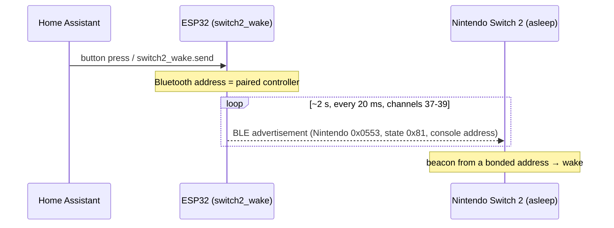

<div align="center">

# Nintendo Switch 2 ESP32 Waker

**Wake a sleeping Nintendo Switch 2 from Home Assistant, a voice assistant or another controller — with a ~$5 ESP32 and no mechanical parts.**

[](https://esphome.io)
[](https://www.espressif.com)
[](https://www.home-assistant.io)
[](LICENSE)

</div>

---

The Switch 2 cannot be turned on over the network, HDMI-CEC or USB. What *does* wake it is a short Bluetooth Low Energy beacon that a paired Joy-Con 2 or Pro Controller 2 broadcasts when you press **HOME**. That beacon is unencrypted and involves no handshake — so an ESP32 that knows your controller's and console's Bluetooth addresses can send the exact same thing.

This repository packages that idea as a clean, reusable **ESPHome external component**, plus the tooling to capture your own values and the recipes to wire it into Home Assistant.

## Features

- **One button in Home Assistant** that wakes the console within a couple of seconds.
- **Wake on another controller** — e.g. press the Xbox button on an Xbox Wireless Controller and the Switch 2 is awake before the controller reconnects. Runs entirely on the ESP32.
- **Voice control** through Home Assistant (Alexa, Google, Assist).
- **No firmware hacks, no hardware mods.** Nothing is opened, soldered or attached to the console or the controller.
- **Wi-Fi untouched.** Only the ESP32's *Bluetooth* address is changed; its Wi-Fi MAC, IP address and Home Assistant registration stay the same.
- **Coexists with ESPHome's Bluetooth proxy and BLE tracker** on the same board.

## How it works



The console's Bluetooth controller keeps scanning while the system sleeps. When it receives a manufacturer-specific advertisement with Nintendo's company ID, the *reconnect* state flag and **its own Bluetooth address**, sent **from the address of a bonded controller**, it wakes the host. Bonding is the only authentication involved, which is why the sender address must be your controller's. The full byte layout is documented in [`docs/packet-format.md`](docs/packet-format.md).

## Requirements

| | |
|---|---|
| **Board** | Any ESP32 with BLE: the classic ESP32 (WROOM/WROVER, `esp32dev`) is tested. ESP32-C3/S3 should work. **Not** the ESP32-S2 (no Bluetooth). |
| **Power** | A proper USB wall adapter. Weak hubs and docks can brown out the board when Wi-Fi starts (see [Troubleshooting](#troubleshooting)). |
| **Controller** | A Joy-Con 2 or Pro Controller 2 **already paired** with the console, used once to capture the beacon. It keeps working normally afterwards. |
| **Software** | ESPHome 2026.9 or newer, `esp-idf` framework. Home Assistant is optional. |
| **Placement** | Within a few meters of the console. Line of sight is not required. |

## Quick start

### 1. Capture your wake packet

The packet contains your console's address, and the sender must be your controller's address. Capture both once:

<details open>
<summary><b>Option A — with the ESP32 itself (no phone, no Home Assistant)</b></summary>

1. Flash [`examples/capture.yaml`](examples/capture.yaml) and open the logs: `esphome logs capture.yaml`.
2. Put the Switch 2 to sleep, **detach a Joy-Con 2** and keep it near the ESP32.
3. Press **HOME** on the Joy-Con. You will see a line like:

   ```text
   [I][capture]: Nintendo advertisement from AA:BB:CC:DD:EE:01 (RSSI -64): 0100037E05662000018102EEDDCCBBAA0F00000000000000
   ```

</details>

<details>
<summary><b>Option B — with an existing Bluetooth proxy in Home Assistant</b></summary>

Any ESPHome Bluetooth proxy already reports advertisements to Home Assistant. Open **Settings → Devices & services → Bluetooth → Advertisement monitor**, press **HOME** on the detached Joy-Con 2, and look for a device with manufacturer `1363` (0x0553). Copy its address and manufacturer data.

</details>

<details>
<summary><b>Option C — with a phone</b></summary>

On Android, run **nRF Connect** (Scanner, no filters), press **HOME** on the detached Joy-Con 2 and open the new entry's raw data. iOS does not expose Bluetooth addresses and cannot be used.

</details>

Then decode it:

```console
$ python3 tools/decode_wake_packet.py 0100037E05662000018102EEDDCCBBAA0F00000000000000 --controller AA:BB:CC:DD:EE:01
Product ID   0x2066 (joycon2_left)
State        0x81 (wake / reconnect)
Console      AA:BB:CC:DD:EE:02

switch2_wake:
  controller_mac: "AA:BB:CC:DD:EE:01"
  console_mac: "AA:BB:CC:DD:EE:02"
  product_id: joycon2_left
```

> [!NOTE]
> The console's Bluetooth address is usually **different** from its Wi-Fi MAC address. Always take it from the captured packet.

### 2. Flash the waker

Start from [`examples/switch2-waker.yaml`](examples/switch2-waker.yaml), paste the three values from the decoder and add a `secrets.yaml` based on [`examples/secrets.yaml.example`](examples/secrets.yaml.example).

```yaml
external_components:
  - source: github://thiagobucca/nintendo-switch2-esp32-waker
    components: [switch2_wake]

esp32_ble:
  id: ble

switch2_wake:
  id: switch2
  controller_mac: "AA:BB:CC:DD:EE:01"
  console_mac: "AA:BB:CC:DD:EE:02"
  product_id: joycon2_left

button:
  - platform: switch2_wake
    switch2_wake_id: switch2
    name: Wake Switch 2
```

```console
$ esphome run switch2-waker.yaml
```

The example ships without Wi-Fi credentials: on first boot the board opens a `switch2-waker` access point — join it from your phone and pick your network (or provision over USB with [Improv](https://www.improv-wifi.com/)).

### 3. Test it

Reattach the Joy-Con, put the console to sleep, wait a few seconds and press **Wake Switch 2** in Home Assistant. The console should turn on within a couple of seconds.

## Configuration reference

```yaml
switch2_wake:
  id: switch2
  controller_mac: "AA:BB:CC:DD:EE:01"
  console_mac: "AA:BB:CC:DD:EE:02"
  product_id: joycon2_left
  duration: 2s
  interval: 20ms
```

| Option | Required | Default | Description |
|---|:---:|---|---|
| `controller_mac` | ✔ | — | Bluetooth address of a controller paired with the console. The ESP32 advertises **as** this address. |
| `console_mac` | ✔ | — | Bluetooth address of the Switch 2, as decoded from the capture. |
| `product_id` | | `joycon2_left` | Controller product ID embedded in the beacon. `joycon2_left` (0x2066), `joycon2_right` (0x2067), `pro_controller2` (0x2069) or any hex value. Use the one you captured. |
| `duration` | | `2s` | Length of each burst (100 ms – 30 s). |
| `interval` | | `20ms` | Advertising interval inside a burst (20 ms – 1 s). |
| `ble_id` | | auto | ID of the `esp32_ble` component, if you have several. |

**Button platform** — `platform: switch2_wake` with `switch2_wake_id`, plus any standard [button](https://esphome.io/components/button/) option.

**Action** — `switch2_wake.send` sends one burst from any automation:

```yaml
on_...:
  - switch2_wake.send: switch2
```

Repeated calls while a burst is running are ignored.

## Recipes

### Wake when another controller turns on

Bluetooth LE controllers that are *not* paired with the console — for instance an Xbox Wireless Controller used through a USB Bluetooth adapter on the dock — broadcast an undirected advertisement while they search for their host. The ESP32 can listen for it and wake the console first:

```yaml
esp32_ble_tracker:
  scan_parameters:
    active: false
  on_ble_advertise:
    - mac_address: "AA:BB:CC:DD:EE:03"   # your controller
      then:
        - script.execute: wake_from_controller

script:
  - id: wake_from_controller
    mode: single          # ignore re-triggers while running…
    then:
      - switch2_wake.send: switch2
      - delay: 60s        # …so it fires at most once a minute
```

The complete version, with an on/off switch exposed to Home Assistant, is in [`examples/switch2-waker-controller-trigger.yaml`](examples/switch2-waker-controller-trigger.yaml). To find your controller's address, temporarily add `bluetooth_proxy:` and watch Home Assistant's advertisement monitor while you press its power button with the console asleep.

> [!IMPORTANT]
> This only works for controllers that advertise over **Bluetooth LE**. Bluetooth Classic controllers — the Switch 1 Pro Controller and most 8BitDo models in Switch mode — reconnect by paging their host directly, which a BLE scanner cannot observe.

### Home Assistant, dashboards and voice

The button appears in Home Assistant as soon as the device is adopted. For state tracking, voice assistants and dashboard ideas, see [`docs/home-assistant.md`](docs/home-assistant.md).

## Troubleshooting

<details>
<summary><b>The console does not wake</b></summary>

- Check the boot log: `Active Bluetooth address` must equal `controller_mac`.
- Re-capture. Pairing the controller again, pairing it with another console or swapping consoles changes the values.
- Make sure the captured state byte was `0x81`. A packet captured while *pairing* (`0x00`) will not wake the console.
- Move the ESP32 closer and check that the real controller is attached to the console or off.

</details>

<details>
<summary><b>The board keeps rebooting right after "wifi: Starting"</b></summary>

`Brownout detector was triggered` in the serial log means the supply sags when the Wi-Fi radio powers up. Use a wall adapter and a short cable instead of a hub or dock. After ten failed boots ESPHome enters **safe mode** (only Wi-Fi and OTA, port 3232; the API on 6053 stays closed). Once power is fixed, run `esphome upload` over the network once to leave it.

</details>

<details>
<summary><b>Will this change my ESP32's Wi-Fi MAC or IP?</b></summary>

No. The component uses `esp_iface_mac_addr_set(…, ESP_MAC_BT)` so that **only the Bluetooth interface** takes the controller's address. Overriding the base MAC instead would also change the Wi-Fi MAC, giving the board a new DHCP lease and breaking its Home Assistant registration.

</details>

<details>
<summary><b>Can it put the console to sleep?</b></summary>

No. The Switch 2 accepts no sleep command over Bluetooth or the network. Use the console's own power menu, or enable **Match TV Power State** in the console settings so it sleeps when the TV turns off via HDMI-CEC.

</details>

## Limitations

- **Switch 2 only.** The original Switch wakes from a Bluetooth Classic connection from a paired controller, which requires its link key — not just a beacon.
- **Per-console, per-controller values.** They change if the controller is re-paired.
- **Firmware updates** may change the wake mechanism at any time.
- Tested with a Joy-Con 2 (product ID 0x2066) on a classic ESP32 (ESP32-D0WD-V3) with ESPHome 2026.9.1. The Pro Controller 2 product ID comes from published research and is untested here.

## Credits

This project stands on the reverse-engineering work of others. No code from these projects is included; the component was written from scratch based on their findings:

- **[tv/switch2-wake-up](https://github.com/tv/switch2-wake-up)** — the first ESPHome and Flipper Zero proof of concept, which showed that replaying the beacon from an ESP32 wakes the console.
- **[alexvnesta/switch2controller](https://github.com/alexvnesta/switch2controller)** — byte-level documentation of the wake packet, burst timing and the bonded-address requirement.
- **[ndeadly/switch2_controller_research](https://github.com/ndeadly/switch2_controller_research)** — research into the Switch 2 controller BLE, HID and pairing protocols.
- **[Lon.TV](https://blog.lon.tv/2025/10/25/how-to-wake-a-switch-2-with-8bitdo-pro-3-or-ultimate-2-controllers/)** — on third-party controllers that wake the Switch 2 natively.

## License

[MIT](LICENSE).

## Disclaimer

This is an independent project, not affiliated with, endorsed or sponsored by Nintendo. Nintendo Switch, Joy-Con and related names are trademarks of Nintendo. It only reproduces a signal your own controller already sends to your own console; use it with devices you own.
